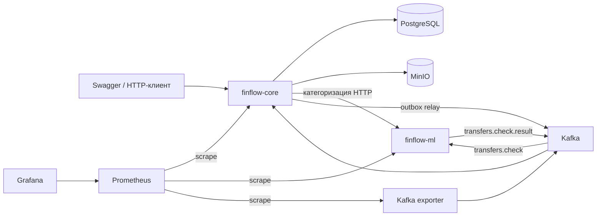

# FinFlow

Учебный сервис личных финансов: счета, переводы с двойной записью, асинхронный антифрод,
импорт выписок, категоризация, бюджеты и аналитика. Внешний платёжный шлюз эмулируется.

## Возможности и стек

- Регистрация, JWT access/refresh с ротацией, роли USER, ANALYST и ADMIN.
- Счета RUB, USD и EUR; перевод всегда в одной валюте.
- Append-only леджер, материализованные балансы, блокировки, сверка и идемпотентность.
- Transactional outbox, Kafka, дедупликация событий, ретраи и DLT.
- Резервирование средств до решения антифрода, fallback-правила и ручной разбор.
- CSV → MinIO → Spring Batch: нормализация, дедупликация, отчёт ошибок.
- Категоризация по правилам, MCC и ML; бюджеты с порогами 80% и 100%.
- SQL-аналитика, materialized view, Envers и бизнес-журнал аудита.
- Экспорт метрик, Prometheus, Kafka exporter и provisioned-дашборд Grafana.

| Компонент | Технологии |
|---|---|
| Core | Java 21, Spring Boot 3.3.5, Gradle Kotlin DSL, JPA, Flyway, Spring Security |
| Обработка | Spring Batch, MapStruct, Resilience4j, Bucket4j, ShedLock, springdoc |
| Хранилища и события | PostgreSQL 16, Kafka 3.8 в KRaft-режиме, MinIO |
| ML | Python 3.11, FastAPI, aiokafka, scikit-learn |
| Метрики | Micrometer, Prometheus, Grafana |
| Тесты | JUnit 5, Testcontainers, ArchUnit, pytest, JSON Schema |

## Архитектура



Core — модульный монолит с одной PostgreSQL, источником истины по деньгам.
Признаки антифрода считает Java; Python не обращается к основной БД.

Модули: auth, account, ledger, transfer, importing, categorization, budget, analytics,
audit. Общая инфраструктура — common и observability. Контракты находятся в api;
внутренние классы соседнего модуля закрыты архитектурными тестами.
Решения и компромиссы: [ADR.md](ADR.md).

```text
finflow-core/          Java-приложение и тесты
finflow-ml/            Python API, Kafka consumer, обучение и тесты
contracts/            JSON Schema и примеры событий
infra/                Compose, Kafka, Prometheus и Grafana
.github/workflows/    Java CI
ADR.md                Архитектурные решения
```

## Быстрый запуск

Нужны Docker Engine / Docker Desktop с Linux containers и Compose v2.
На Windows должен работать WSL 2. Для полного запуска локальные JDK и Python не нужны.
Команды выполняются из корня репозитория.

1. Создать локальное окружение:

```powershell
Copy-Item .env.example .env
```

Для Bash: `cp .env.example .env`.

2. Заменить шаблонные значения в `.env`:

| Переменная | Назначение |
|---|---|
| PG_PASSWORD | Пароль PostgreSQL |
| JWT_SECRET | Случайный секрет JWT, не короче 64 символов |
| ML_API_KEY | Общий ключ core → ML |
| MINIO_ROOT_USER, MINIO_ROOT_PASSWORD | Доступ к MinIO |
| MONITORING_TOKEN | Отдельный случайный Bearer-токен для scrape |
| GRAFANA_ADMIN_USER, GRAFANA_ADMIN_PASSWORD | Начальная учётная запись Grafana |

Файл `.env` не хранится в Git. Если опубликованные порты заняты другими проектами,
изменить настройки портов. PostgreSQL сейчас опубликован на фиксированном порту 5432.

3. Проверить конфигурацию и запустить:

```shell
docker info
docker compose --env-file .env -f infra/docker-compose.yml config --quiet
docker compose --env-file .env -f infra/docker-compose.yml up --build -d
docker compose --env-file .env -f infra/docker-compose.yml ps
```

Первая сборка скачивает зависимости и обучает baseline-модели на синтетике.
Flyway создаёт схему, категории и системные счета. Демо-пользователей и кошельков нет.

| Сервис | Адрес по умолчанию |
|---|---|
| Core Swagger | http://localhost:8080/swagger-ui/index.html |
| Core OpenAPI | http://localhost:8080/v3/api-docs |
| Core health | http://localhost:8080/actuator/health |
| Core readiness | http://localhost:8080/actuator/health/readiness |
| ML health / Swagger | http://localhost:8000/health / http://localhost:8000/docs |
| Kafka UI | http://localhost:8090 |
| MinIO Console | http://localhost:9001 |
| Prometheus | http://localhost:9090 |
| Grafana | http://localhost:3000 |

В Grafana автоматически появляется папка и дашборд **Finflow**.
Prometheus и Grafana опубликованы только на loopback.
Пароль Grafana из окружения применяется при создании её хранилища; изменение переменной
не сбрасывает пароль существующего пользователя.

```shell
docker compose --env-file .env -f infra/docker-compose.yml logs --tail=100 finflow-core finflow-ml
docker compose --env-file .env -f infra/docker-compose.yml down
```

Обычный `down` сохраняет именованные тома с данными.

## Демо: перевод и идемпотентность

Через Swagger: зарегистрироваться, выполнить login, вставить accessToken в Authorize,
открыть два счёта, пополнить первый и создать перевод. Ниже тот же сценарий для PowerShell 5.1+.
При изменённом CORE_PORT исправить `$base`.

```powershell
$base = "http://localhost:8080/api/v1"
function Send-Finflow {
    param($Method, $Path, $Token, $Body, $Key)
    $request = @{ Method = $Method; Uri = "$base$Path"; Headers = @{}; TimeoutSec = 30 }
    if ($Token) { $request.Headers.Authorization = "Bearer $Token" }
    if ($Key) { $request.Headers["Idempotency-Key"] = $Key }
    if ($null -ne $Body) {
        $request.ContentType = "application/json"
        $request.Body = [Text.Encoding]::UTF8.GetBytes(($Body | ConvertTo-Json -Compress))
    }
    Invoke-RestMethod @request
}

$email = "demo-$([guid]::NewGuid().ToString('N'))@example.com"
$password = "Finflow-demo-password-2026"
Send-Finflow POST "/auth/register" -Body @{
    email = $email; password = $password; fullName = "Demo User"
} | Out-Null
$session = Send-Finflow POST "/auth/login" -Body @{ email = $email; password = $password }
$token = $session.accessToken

$wallet = Send-Finflow POST "/accounts" -Token $token -Body @{
    type = "USER_WALLET"; currency = "RUB"
}
$savings = Send-Finflow POST "/accounts" -Token $token -Body @{
    type = "USER_SAVINGS"; currency = "RUB"
}
Send-Finflow POST "/top-ups" -Token $token -Key ([guid]::NewGuid().ToString()) -Body @{
    accountId = $wallet.id; amount = 1000
}

$key = [guid]::NewGuid().ToString()
$body = @{
    fromAccountId = $wallet.id; toAccountId = $savings.id
    amount = 100; description = "Demo transfer"
}
$transfer = Send-Finflow POST "/transfers" -Token $token -Key $key -Body $body
$replay = Send-Finflow POST "/transfers" -Token $token -Key $key -Body $body
$transfer.id -eq $replay.id
Send-Finflow GET "/transfers/$($transfer.id)" -Token $token
Send-Finflow GET "/accounts" -Token $token
Send-Finflow GET "/accounts/$($wallet.id)/statement" -Token $token
```

Повтор должен вернуть тот же ID. Сохранённый ответ может содержать PENDING_CHECK даже после
завершения перевода: актуальный статус читается через GET. Средства сначала резервируются
на SYSTEM_SUSPENSE. APPROVE завершает перевод, HOLD требует аналитика.
Конкретное решение модели не фиксировано демо-сценарием.

Для новой денежной операции нужен новый UUID Idempotency-Key. Другой запрос с занятым
ключом даёт 422, ещё выполняющийся — 409. Срок хранения ключей — 24 часа с фоновой очисткой.
Access-токен действует 15 минут; `POST /auth/refresh` принимает `{"refreshToken":"..."}`
и возвращает новую пару. Logout отзывает переданный refresh-токен.

## Демо: импорт и бюджет

Продолжение предыдущего сценария. CSV создаётся во временном каталоге, дата — текущий месяц UTC.

```powershell
$day = [DateTime]::UtcNow.ToString("yyyy-MM-dd")
$month = [DateTime]::UtcNow.ToString("yyyy-MM")
$nextMonth = [DateTime]::UtcNow.AddMonths(1).ToString("yyyy-MM") + "-01"
$csv = "date,description,amount,currency,mcc" + [Environment]::NewLine +
       "$day,PYATEROCHKA,-850.00,RUB,5411" + [Environment]::NewLine
$csvPath = Join-Path ([IO.Path]::GetTempPath()) "finflow-demo-$([guid]::NewGuid()).csv"
[IO.File]::WriteAllText($csvPath, $csv, (New-Object Text.UTF8Encoding($false)))
$uploadJson = curl.exe --fail-with-body -sS -H "Authorization: Bearer $token" -F "bankFormat=TINKOFF" -F "file=@$csvPath" "$base/imports"
$import = $uploadJson | ConvertFrom-Json
Send-Finflow GET "/imports/$($import.id)" -Token $token
```

Повторять GET до DONE или FAILED; ответ содержит счётчики и ошибки строк. После DONE:

```powershell
$spending = Send-Finflow GET "/analytics/spending?from=$month-01&to=$nextMonth&currency=RUB" -Token $token
$category = $spending | Where-Object { $_.level -eq "CATEGORY" -and $null -ne $_.categoryId } | Select-Object -First 1
Send-Finflow PUT "/budgets?month=$month" -Token $token -Body @{
    categoryId = $category.categoryId; currency = "RUB"; limit = 1000
}
Send-Finflow GET "/budgets?month=$month" -Token $token
Send-Finflow GET "/analytics/monthly-spending?months=12&currency=RUB" -Token $token
```

Для исходно пустого пользователя пример даёт 850 расходов и пересекает порог 80%.
Событие публикуется в budget.alerts без повторного уведомления о том же пороге.
Отдельного отправщика email/push нет. Импорт не изменяет денежные балансы леджера.

| Формат | Кодировка | Разделитель | Заголовок |
|---|---|---|---|
| TINKOFF | UTF-8 | запятая | date,description,amount,currency,mcc |
| SBER | Windows-1251 | точка с запятой | Дата операции;Описание;Сумма;Валюта;MCC |
| ALFA | UTF-8 | табуляция | Дата, Контрагент, Сумма, Тип, Валюта — отдельные колонки |

SBER использует dd.MM.yyyy, ALFA — dd.MM.yy и тип `списание` / `пополнение`.
Это учебные форматы, а не гарантия совместимости с любой реальной банковской выгрузкой.
Размер файла ограничен 10 МБ; исходник хранится в MinIO. Повторная загрузка дедуплицируется.

## Основные API

Все пути ниже имеют префикс `/api/v1`. Схемы DTO — в Swagger.

| Метод и путь | Назначение |
|---|---|
| POST /auth/register, /auth/login, /auth/refresh, /auth/logout | Пользователь и токены |
| GET /users/me | Текущий пользователь |
| GET/POST /accounts, GET /accounts/{id} | Свои счета |
| POST /top-ups, /withdrawals, /transfers | Денежные операции с Idempotency-Key |
| GET /transfers/{id}, GET /transfers | Статус и история, курсор after |
| GET /accounts/{id}/statement | Проводки, from/to/after/limit |
| POST /imports, GET /imports/{id} | Загрузка и результат импорта |
| GET/POST /category-rules, DELETE /category-rules/{id} | Правила; больший priority применяется раньше |
| GET/PUT /budgets?month=YYYY-MM | Бюджеты по категориям и валютам |
| GET /analytics/spending?from&to&groupBy=category | Категории, итоги месяца и периода |
| GET /analytics/trends?months=6 | Динамика и среднее за три месяца |
| GET /analytics/top-merchants?from&to | Топ-5 рангов в каждой категории, с равными местами |
| GET /analytics/monthly-spending?months=12 | Помесячная витрина |
| GET /admin/transfers?status=ON_HOLD | Очередь аналитика |
| POST /admin/transfers/{id}/approve, /reject | Решение аналитика |
| GET /admin/audit?entity&id&page&size | Ревизии и журнал действий |

Чужие ресурсы дают 404. Ошибки — ProblemDetail.
В аналитике from включается, to исключается, формат дат YYYY-MM-DD, currency по умолчанию RUB.
В выписке леджера from/to — ISO-8601 timestamps, например `2026-10-31T00:00:00Z`.
Пропущенные месяцы в динамике заполняются нулями, деление на нулевой прошлый месяц даёт null.
Витрина читает текущий месяц напрямую, прошлые — из materialized view с обновлением
каждые 15 минут и после событий импорта/категоризации.

## Роли и аудит

Регистрация создаёт USER. Для локального демо зарегистрировать analyst@example.com,
затем изменить роль через БД и выполнить login заново:

```shell
docker compose --env-file .env -f infra/docker-compose.yml exec postgres psql -U finflow -d finflow -c "UPDATE users SET role='ANALYST' WHERE email='analyst@example.com';"
```

ANALYST и ADMIN могут работать с ON_HOLD и читать аудит. Reject требует `{"reason":"..."}`
и возвращает резерв отправителю. Envers хранит ADD/MOD/DEL для счетов, переводов,
бюджетов и правил; журнал решений содержит автора и IP. Типы запроса аудита:
transfer, account, budget, category-rule. Первая ревизия V15 — снимок данных на момент
миграции, а не восстановленная история их создания.

## Денежные инварианты и события

| Действие | Проводки |
|---|---|
| Пополнение | SYSTEM_GATEWAY −X, пользователь +X |
| Создание перевода | Отправитель −X, SYSTEM_SUSPENSE +X |
| APPROVE | SYSTEM_SUSPENSE −X, получатель +X |
| Reject | SYSTEM_SUSPENSE −X, отправитель +X |

Сумма проводок одной транзакции равна нулю в одной валюте. Отложенный триггер проверяет
проводки, CHECK защищает пользовательский баланс от минуса, строки блокируются по ID.
Только LedgerService меняет баланс; он требует существующей бизнес-транзакции.
Ночная сверка запускается в 03:00 UTC.

Outbox сохраняется вместе с бизнес-операцией, доставка — at-least-once.
Падение между Kafka ack и коммитом допускает дубль; обработчики используют дедупликацию
и проверки статуса. End-to-end exactly-once не заявляется.

[Контракты событий](contracts/README.md): transfers.check, transfers.check.result,
transfers.status-changed, transactions.imported, transactions.categorized, budget.alerts.
Ошибки потребителей после ретраев попадают в соответствующие DLT.

## ML и деградация

Реализованы IsolationForest для антифрода и TF-IDF char n-grams + LogisticRegression
для категоризации. Dockerfile обучает артефакты при сборке.

Антифрод асинхронный. После 30 секунд ожидания core применяет fallback-правила;
scheduler проверяет очередь каждые 10 секунд. Поздний ML-ответ не меняет уже обработанное
состояние. Порог HOLD — FRAUD_HOLD_THRESHOLD, по умолчанию 0.7.

Категоризация идёт HTTP-пачками до 500 строк с X-API-Key, timeout, retry и circuit breaker.
Неизвестные строки при сбое остаются без категории и повторно обрабатываются фоновым заданием.

Версии и метрики сохраняются с моделями. У категоризатора отложены целые мерчанты.
Оценка антифрода на части обучающей синтетики демонстрационная и не доказывает качество
на реальных платежах. CatBoost, BERT, ONNX и SHAP в текущий runtime не входят.

## Мониторинг

Prometheus собирает core, ML и Kafka exporter. Grafana показывает HTTP RPS/p95/ошибки,
статусы и проверки переводов, outbox, сверку, Kafka lag, ML-клиент, JVM и пул соединений.

`GET /actuator/prometheus` принимает ADMIN JWT или Bearer MONITORING_TOKEN.
Токен мониторинга действует только на этом пути. Правила в `infra/prometheus/alerts.yml`
проверяют недоступность сервисов, расхождения леджера, outbox > 1000, ожидание проверки
дольше 120 секунд, HTTP 5xx и Kafka lag. Состояния доступны в Prometheus; внешний Alertmanager
и рассылка уведомлений не настроены. До первых запросов часть графиков может быть пустой.

## Разработка и тесты

### Java

Нужен JDK 21; Wrapper включён. Из корня:

```powershell
Set-Location finflow-core
.\gradlew.bat test
.\gradlew.bat test --tests "*ArchitectureTest" --tests "*ModuleBoundaryConditionTest"
```

Linux/macOS: `cd finflow-core && ./gradlew test`.
ArchUnit работает без Docker; полный набор использует Testcontainers с PostgreSQL, Kafka и MinIO.

Для локального bootRun сначала запустить инфраструктуру из корня:

```shell
docker compose --env-file .env -f infra/docker-compose.yml up -d postgres kafka-init minio
```

Затем экспортировать DB_PASSWORD (из PG_PASSWORD), JWT_SECRET, ML_API_KEY и
`KAFKA_BOOTSTRAP_SERVERS=localhost:29092`. После этого из finflow-core выполнить
`.\gradlew.bat bootRun` или `./gradlew bootRun`.
Spring Boot автоматически не читает корневой .env. Значения для контейнеров передаёт Compose.

### Python

Нужен Python 3.11+. Из finflow-ml создать окружение: `python -m venv .venv`.
Активировать его: PowerShell — `.\.venv\Scripts\Activate.ps1`,
Bash — `source .venv/bin/activate`. Затем:

```shell
python -m pip install -e ".[dev]"
python -m training.train_fraud --output artifacts
python -m training.train_categorizer_baseline --output artifacts
```

Для запуска API экспортировать ML_API_KEY и `KAFKA_BOOTSTRAP_SERVERS=localhost:29092`
при использовании Kafka из Compose, затем:

```shell
python -m uvicorn app.main:app --host 0.0.0.0 --port 8000
```

Для локальной работы без Kafka можно задать `FRAUD_CONSUMER_ENABLED=false`.
Это отключает Python fraud consumer; core продолжает применять fallback.
Необходимо, чтобы команду python запускал интерпретатор из активированного venv.

```shell
python -m pytest
python -m ruff check .
python -m mypy app training
```

Java CI запускает ./gradlew build на Ubuntu и сохраняет отчёты JUnit и JaCoCo.
Отдельного Python CI workflow пока нет. Проверки JSON Schema входят в тесты сервисов.

### Правила Prometheus

Из корня, PowerShell:

```powershell
$monitoringPath = (Resolve-Path infra/prometheus).Path
docker run --rm --entrypoint /bin/promtool --mount "type=bind,source=$monitoringPath,target=/etc/prometheus,readonly" --workdir /etc/prometheus prom/prometheus:v2.55.1 check rules alerts.yml
docker run --rm --entrypoint /bin/promtool --mount "type=bind,source=$monitoringPath,target=/etc/prometheus,readonly" --workdir /etc/prometheus prom/prometheus:v2.55.1 test rules alerts.test.yml
```

## Границы проекта

- Учебная система: нет реальных банковских интеграций и валютной конвертации.
- Общий SYSTEM_SUSPENSE для каждой валюты остаётся горячей строкой под нагрузкой.
- Bucket4j хранит лимиты в памяти процесса; для нескольких экземпляров нужен общий limiter.
- Историческая аналитика может отставать на интервал refresh.
- Нет клиентского финансового UI, отправщика email/push и внешней маршрутизации алертов.
- JSON-логирование и сквозной distributed tracing из исходного замысла ещё не реализованы.
- Нагрузочные цифры, EXPLAIN на миллионах строк и production-качество ML без измерений не заявляются.
